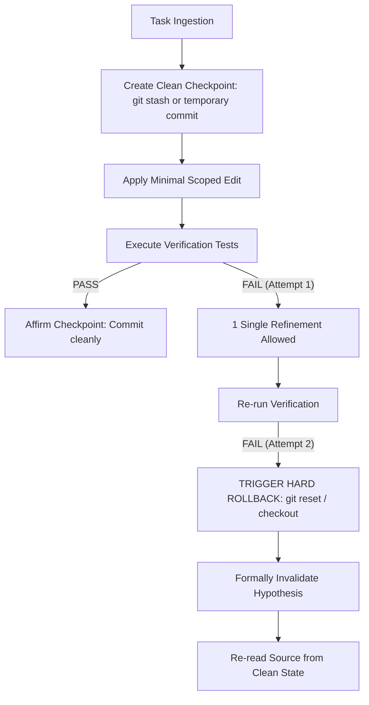

# Atomic Rollback Guard Protocol

A prevalent failure pattern in autonomous coding benchmarks is "patching the patch": when an agent's initial fix fails tests, instead of reverting to the clean baseline, it adds another layer of tentative edits. This escalates into cascading syntax errors, token budget exhaustion, and broken repository state.

The Atomic Rollback Guard establishes clean restore checkpoints before modifying code, enforcing a mandatory hard rollback when mutations fail verification gates.

## The Atomic Mutation Cycle



## Step 1: Establish the Restore Checkpoint

Before touching any source files or running invasive scripts, record a clear checkpoint:

```bash
# Check working tree cleanliness
git status --porcelain

# Option A: Save temporary stash checkpoint
git stash create

# Option B: Create local checkpoint branch or commit
git commit -am "checkpoint: baseline before refactoring"
```

Save the resulting commit or stash hash in memory as `CHECKPOINT_REF`.

## Step 2: Apply Scoped Modifications

- Modify only the files directly responsible for the target requirement.
- Never modify unrelated tests to force a failing assertion to pass.
- Run the localized test suite immediately following file edits.

## Step 3: Verification Gate & Two-Strike Rule

Run the automated test runner:

```bash
pytest tests/test_target.py -q
```

- **If tests pass:** Proceed to permanent commit.
- **If tests fail on Attempt 1:** One targeted refinement is permitted if the failure reveals a missing import, syntax typo, or edge condition.
- **If tests fail on Attempt 2:** Stop editing immediately. Do not attempt a third patch.

## Step 4: Execute Hard Rollback

When the two-strike limit is reached:

```bash
# Revert all working tree changes back to the checkpoint baseline
git checkout -- .
git clean -fd
```

Declare explicitly in your response:
*"Mutations failed verification twice. Reverted workspace to clean checkpoint. Invalidate current approach."*

For detailed decision thresholds and command variants across different version control states, review `references/rollback-decision-tree.md`.
