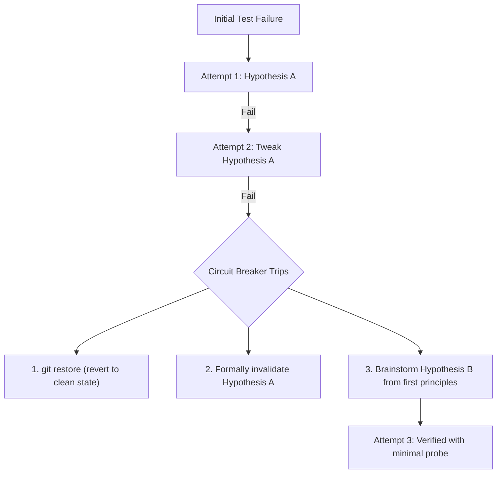

# Cognitive Loop Breaker Protocol

The most common failure mode in autonomous coding is the "trial-and-error death spiral": an agent makes an edit, tests fail, it tweaks one line, tests fail again, and it repeats minor variations until token limits or context budgets expire. Follow this circuit-breaker protocol to force a hard cognitive reset.

## The Three-Strikes Circuit Breaker

### Strike 1: Initial Hypothesis
- Formulate an explicit hypothesis: *"The test fails because condition X does not handle None."*
- Apply a minimal fix and run the test.

### Strike 2: Refinement
- If the test still fails, you may perform **one** targeted refinement to verify if an edge case was missed.

### Strike 3: Mandatory Circuit Trip
If Attempt 2 fails with the same symptom:
1. **Freeze Execution**: Do not make further edits to the codebase.
2. **Revert Workspace**: Run `git restore .` (or stash changes) to eliminate polluted speculative edits and return to a clean working state.
3. **Invalidation Log**: State explicitly:
   - *"Hypothesis A was: [Hypothesis] - This has been disproven because [Evidence]."*
4. **First-Principles Re-examination**:
   - Re-read the original issue or error trace from the outermost boundary.
   - Question foundational assumptions: Is the bug in the tested code, the test environment, or an upstream dependency?
5. Formulate Hypothesis B before making another edit.
