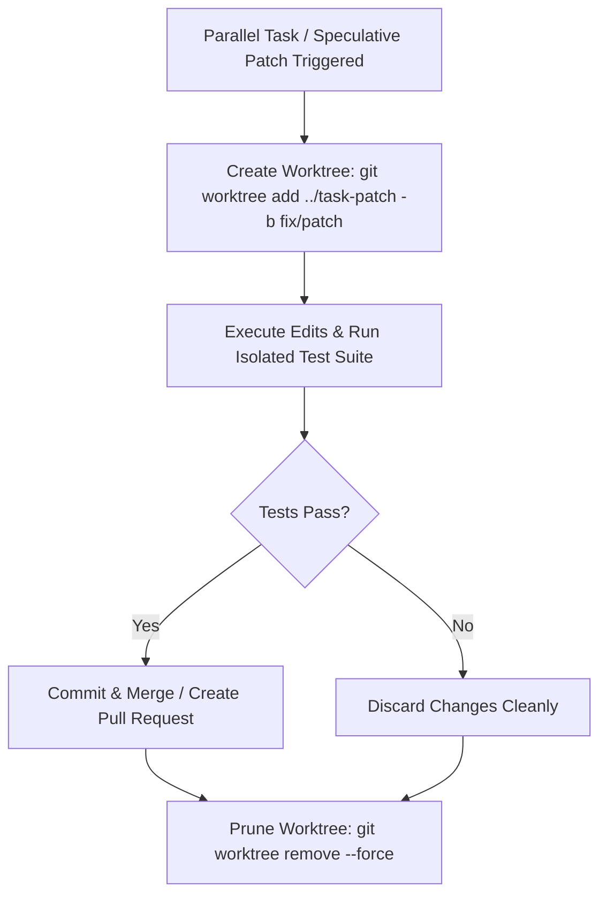

# Git Worktree Isolation Protocol

Autonomous coding agents executing parallel workflows or speculative edits in a shared working tree face severe state pollution: uncommitted edits from failed hypotheses bleed into subsequent tasks, and Git index lock files (`.git/index.lock`) trigger race condition crashes.

Use isolated Git worktrees to decouple concurrent task executions, keep the primary working tree pristine, and guarantee clean rollback boundaries.

## The Worktree Lifecycle



## Step 1: Provision an Isolated Worktree

Create a dedicated worktree in a sibling directory outside the main working copy:

```bash
# Create worktree with a fresh feature branch off main
git worktree add ../agent-task-worker -b task/isolated-patch main
```

Navigate to the isolated directory for all subsequent edits and test runs:

```bash
cd ../agent-task-worker
```

## Step 2: Execute Edits and Verification

Perform file edits, dependency installs, and test runs inside the isolated worktree directory.
Because the primary working directory remains untouched:
- Background dev servers in the main tree continue running without interruption.
- Other subagents work concurrently on separate files without lock contention.
- Local configuration files are isolated.

Run tests directly inside the worktree:

```bash
pytest tests/test_patch.py
```

## Step 3: Resolution and Teardown

### If the Fix Succeeded
Commit changes on the isolated branch and push:

```bash
git add .
git commit -m "fix: resolve isolated issue cleanly"
git push origin task/isolated-patch
```

### If the Fix Failed or Must Be Discarded
No manual file reverts or git reset operations are needed in your main tree. Return to the main tree and tear down the worktree:

```bash
# Return to main workspace
cd ../main-repo

# Remove the isolated worktree
git worktree remove --force ../agent-task-worker

# Prune administrative records
git worktree prune
```

For detailed removal steps, lock handling, and multi-agent coordination rules, consult `references/worktree-cleanup-protocol.md`.
