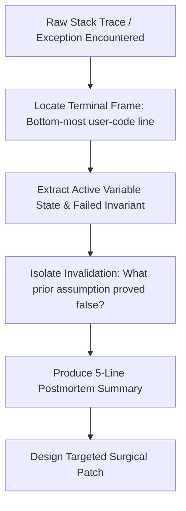

# Traceback Postmortem Protocol

Dumping 200 lines of raw compiler or test runner stack traces into an agent conversation dilutes the model's attention window, increases token expenditure, and anchors the LLM on superficial errors rather than foundational bugs.

The Traceback Postmortem protocol filters raw tracebacks into an actionable 5-point root-cause diagnosis before writing code.

## The Traceback Distillation Workflow



## Step 1: Isolate the Terminal Frame

In lengthy tracebacks, ignore framework boilerplates (e.g. pytest internals, ASGI dispatchers, database drivers). Identify the deepest stack frame within project code:

1. Record the exact file path and line number of the failing assertion or call.
2. Note the exception class (e.g., `KeyError`, `AssertionError`, `TypeError`, `OperationalError`).
3. Note the exact arguments passed into the terminal frame.

## Step 2: Formulate the 5-Line Postmortem

Before proposing or editing any file, emit the following standardized distillation:

```text
POSTMORTEM DIAGNOSIS:
1. Terminal Frame: src/auth/token.py:84 in verify_payload()
2. Exception: KeyError: 'exp'
3. Broken Invariant: Payload dictionary was expected to have 'exp' claim, but received unsigned refresh token schema.
4. Invalidated Assumption: The issue is not token signature verification; it is caller passing refresh token to access token decoder.
5. Surgical Fix Target: Validate 'token_type' header at src/auth/token.py:62 before decoding claims.
```

## Step 3: Prevent Symptom Masking

Never resolve a traceback by:
- Wrapping the failing line in an overly broad `try...except Exception: pass`.
- Altering the test assertion to accept an erroneous output.
- Hardcoding expected return values to satisfy a single test runner run.

For complex hierarchical failures spanning multiple services or modules, apply the deep root cause analysis process detailed in `references/5-whys-template.md`.
