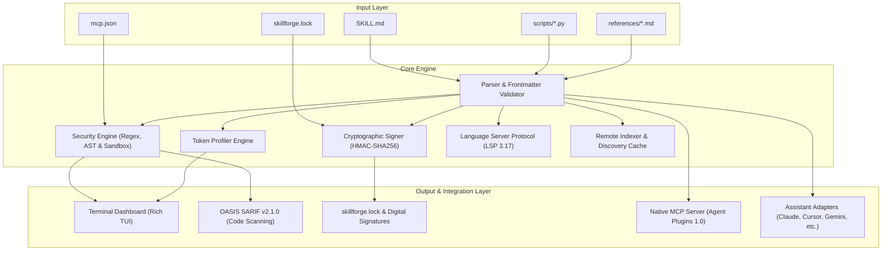

# Architecture and Design

This document details the internal design, component boundaries, and execution pipeline of SkillForge.

---

## Architectural Principles

SkillForge is built around four fundamental engineering constraints:

1. **Zero External Network Dependencies for Auditing:** Auditing must be completely offline, deterministic, and sandboxed. No skills or prompts are sent to external LLMs or third-party APIs during security evaluation.
2. **Defensive Parsing:** All file inputs (YAML frontmatter, Markdown AST, zipped packages, Python scripts) are treated as untrusted and potentially adversarial.
3. **Progressive Disclosure First:** Agent context is expensive. Skills are modeled in two distinct lifecycle phases: the lightweight startup pointer and the heavy on-demand execution body.
4. **Universal Interoperability:** A single skill package must run identically across all major AI coding assistants without vendor lock-in.

---

## System Architecture

---

## Core Components

### 1. Skill Parser and Frontmatter Validator (`src/skillforge/skill.py`)

The parser decomposes `SKILL.md` into structured data:
* **YAML Frontmatter Extraction:** Safely extracts `name`, `description`, `version`, `tags`, and `allowed-tools` using PyYAML with strict safe loading (`yaml.SafeLoader`).
* **Markdown AST Segmentation:** Divides the document into instruction blocks, fenced code blocks, reference links, and scripts.
* **Resource Pointer Mapping:** Resolves relative paths to `references/` and `scripts/` directories while enforcing path traversal bounds.

### 2. Security Engine (`src/skillforge/security.py`)

The security subsystem executes multi-tier analysis on skill packages:

* **Unicode Sanitizer (SEC-001):** Scans the raw character stream for invisible zero-width spaces (`\u200B`, `\uFEFF`), bidirectional override markers (`\u202E`, `\u2066`), and deceptive homoglyphs used to manipulate model tokenization.
* **Prompt Injection Matcher (SEC-002):** Evaluates prompts for jailbreak instructions and safety boundary overrides. Differentiates between defensive quotations (flagged as `MEDIUM`) and imperative directives (flagged as `CRITICAL`).
* **Dangerous Shell and Credential Rules (SEC-003 to SEC-007):** Flags pipelines like `curl | bash`, base64 command execution, access to `~/.ssh` or `~/.aws`, outbound webhook exfiltration sinks, and spoofed markdown links.
* **Python AST Taint Analyzer (SEC-008):** Bundled Python scripts under `scripts/` are parsed using Python's native `ast` module. The analyzer inspects the syntax tree for dynamic execution sinks (`eval()`, `exec()`), shell execution invocations (`subprocess.Popen(..., shell=True)`), and taint propagation paths where environment secrets flow into network requests.
* **Offline Execution Sandbox Harness:** Isolates bundled Python scripts inside a restricted subprocess environment blocking outbound socket connections and secondary process spawning.
* **Allowed-Tools Scope Verifier (SEC-012):** Enforces that shell commands or scripts in the skill body do not violate tool restrictions declared in frontmatter.
* **Persistent Memory Protection (SEC-013):** Blocks unauthorized append or overwrite operations targeting `AGENTS.md`, `CLAUDE.md`, `.cursorrules`, or `.git/hooks/*`.
* **Lethal Trifecta Compound Risk (SEC-014):** Identifies compound risks where private credential access, untrusted input ingestion, and network egress are combined in a single package.
* **Obfuscation and Resource Abuse (SEC-015 to SEC-017):** Detects base64/hex execution wrappers, fork bombs, disk wipers, and unpinned runtime package installations.
* **MCP Configuration Auditor (MCP-001 to MCP-004):** Scans Model Context Protocol configurations for plaintext secrets, arbitrary shell interpreters, unpinned packages, and root filesystem grants.

### 3. Token Budget Engine (`src/skillforge/optimizer.py`)

The context profiler calculates exact and estimated token usage:

$$\text{Total Turn Cost} = \text{Always-Loaded Pointer Cost} + \mathbb{I}(\text{Triggered}) \times \text{On-Demand Body Cost}$$

* **Startup Pointer Cost:** The token count of the skill `name` and `description` injected into the system prompt on every conversational turn.
* **On-Demand Body Cost:** The token count of the core instructions loaded into context only when triggered.
* **Disclosed Resources:** The token count of supplementary manuals stored in `references/`, pulled only as needed.

### 4. Cryptographic Attestation Subsystem (`src/skillforge/signing.py`)

Computes canonical SHA-256 file manifest trees and HMAC-SHA256 release signatures for both skill directories and project lockfiles, providing instant tamper detection.

### 5. Language Server Protocol Daemon (`src/skillforge/lsp.py`)

Implements an LSP 3.17 server communicating over standard input and output. Evaluates YAML frontmatter syntax, token budgets, and security patterns in real time as files are typed or saved in modern code editors.

### 6. Assistant Adapters (`src/skillforge/adapters.py`)

SkillForge maintains platform-agnostic mappings to write skills into canonical configuration locations:

| Target Platform | Detection Marker | Installed Skill Path |
| :--- | :--- | :--- |
| **Claude Code & Desktop** | `.claude/` | `.claude/skills/<name>/SKILL.md` |
| **Cursor** | `.cursor/` | `.cursor/skills/<name>/SKILL.md` |
| **Google Antigravity** | `.gemini/` | `.gemini/config/skills/<name>/SKILL.md` |
| **Windsurf** | `.windsurf/`, `.windsurfrules` | `.windsurf/skills/<name>/SKILL.md` |
| **Cline / Roo-Code** | `.cline/`, `.roomodes` | `.cline/skills/<name>/SKILL.md` |
| **Universal Agents** | `.agents/` | `.agents/skills/<name>/SKILL.md` |
| **Global Workspace Catalog** | `AGENTS.md` | Appended to `AGENTS.md` skill table |
| **GitHub Copilot** | `.github/` | Appended to `.github/copilot-instructions.md` |

---

## Model Context Protocol (MCP) Integration

SkillForge ships with a standard Model Context Protocol server (`skillforge serve-mcp`), allowing AI coding assistants to audit, read, and manage skills autonomously inside their development loop.

The server implements the Agent Plugins 1.0 specification and exposes:

* `search_skills(query, limit)`: Search local and built-in skill registries.
* `get_skill(name)`: Fetch the complete `SKILL.md` instructions for an active skill.
* `get_skill_resource(name, resource_path)`: Fetch on-demand reference guides and scripts with built-in path containment.
* `validate_skill(content)`: In-memory validation of skill YAML frontmatter.
* `audit_skill(content)`: In-memory security and quality audit returning structured findings.
* `skill://{name}`: Resource URI for direct document retrieval.
