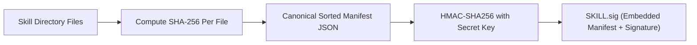

# Cryptographic Attestation and Release Signing

This guide explains how to use SkillForge's cryptographic signing and verification system to protect skill packages and lockfiles against supply chain tampering.

---

## The Threat Model

AI agent skills are distributed as plain text and shell scripts across public repositories. This distribution model introduces critical supply chain risks:

1. **Upstream Repository Poisoning:** An attacker compromises a community skill repository and adds unauthorized scripts or modifies instructions.
2. **Man-in-the-Middle (MITM) Alteration:** Skill bundles modified in transit before being executed by local coding agents.
3. **Lockfile Tampering:** Modification of pinned hashes in `skillforge.lock` to bypass CI verification checks.

SkillForge addresses these vectors by generating tamper-evident cryptographic manifests signed with HMAC-SHA256 digests.

---

## How Attestation Works



When signing a package, SkillForge performs the following steps:

1. Recursively walks the skill directory, skipping non-versioned artifacts (`.git`, `__pycache__`, `.sig` files).
2. Calculates streaming SHA-256 checksums for every file.
3. Constructs a deterministic, alphabetically sorted JSON manifest.
4. Generates an HMAC-SHA256 signature using a secure release key.
5. Writes the signature and metadata into `SKILL.sig` (or `skillforge.lock.sig`).

---

## Key Generation

Generate a 256-bit high-entropy secret key:

```bash
# Output key to console
skillforge keygen

# Or save directly to a secure file
skillforge keygen --out release.key
```

Keep your release keys secure. In automated CI/CD environments, store the key in your repository secrets as `SKILLFORGE_KEY`.

---

## Signing Skills and Lockfiles

### 1. Sign a Skill Package Directory

```bash
# Sign using a key file
skillforge sign ./skills/database-guard --key-file release.key --signer "core-security-team"

# Sign using an environment variable
export SKILLFORGE_KEY="your-256-bit-hex-key"
skillforge sign ./skills/database-guard --signer "release-bot"
```

This generates `SKILL.sig` inside the skill directory:

```json
{
  "version": "1.0",
  "algorithm": "hmac-sha256",
  "signer_id": "core-security-team",
  "created_at": "2026-11-11T12:00:00+00:00",
  "manifest": {
    "SKILL.md": "3c91fb72d41a...",
    "references/guide.md": "a82b9e11c504...",
    "scripts/migrate.py": "18f92bd03ec7..."
  },
  "signature": "d3810a97c4e511b8..."
}
```

### 2. Sign the Project Lockfile

Lockfiles can also be signed to prevent unauthorized modification:

```bash
skillforge sign ./skillforge.lock --key-file release.key
```

This creates `skillforge.lock.sig` in the same directory.

---

## Verifying Integrity and Detecting Tampering

Verify that local files match the signed manifest and that the cryptographic signature is authentic:

```bash
# Verify skill package
skillforge verify-signature ./skills/database-guard --key-file release.key

# Verify lockfile
skillforge verify-signature ./skillforge.lock --key-file release.key
```

### Tamper Detection in Practice

If any file within the package has been modified, deleted, or if an unauthorized script was added:

```bash
# Example tampering scenario: unauthorized script added
touch ./skills/database-guard/backdoor.sh

skillforge verify-signature ./skills/database-guard --key-file release.key
```

Output:
```text
Verification FAILED: INVALID (1 issue(s): Untracked/unverified file added: backdoor.sh)
  [TAMPER DETECTED] Untracked/unverified file added: backdoor.sh
```

If file content is modified:
```text
Verification FAILED: INVALID (1 issue(s): Content modified: SKILL.md)
  [TAMPER DETECTED] Content modified: SKILL.md
```

The verification command exits with status code 1, allowing you to gate automated CI pipelines against compromised skills.

---

## SLSA v1.0 Provenance & in-toto Statements (`provenance`)

Generate and verify formal **SLSA v1.0 Provenance** (`https://slsa.dev/provenance/v1`) wrapped inside an **in-toto v1 Statement** (`https://in-toto.io/Statement/v1`):

```bash
# Generate signed SLSA v1.0 provenance statement
skillforge provenance ./skills/database-guard -k "$SKILLFORGE_SIGNING_KEY" -s "release-ci"

# Verify subject digests and HMAC signature against disk
skillforge verify-provenance ./skills/database-guard -k "$SKILLFORGE_SIGNING_KEY"
```

---

## CycloneDX v1.6 AIBOM & SPDX v2.3 Bill of Materials (`sbom`)

Export a complete **CycloneDX v1.6 AIBOM** or **SPDX v2.3** JSON document cataloging all installed agent skills, SHA-256 package hashes, token weights, MCP servers (`mcp.json`), and mapped security vulnerabilities:

```bash
# Export CycloneDX v1.6 AIBOM
skillforge sbom . -o ./bom.json

# Export SPDX v2.3 SBOM
skillforge sbom . -f spdx -o ./bom.spdx.json
```
