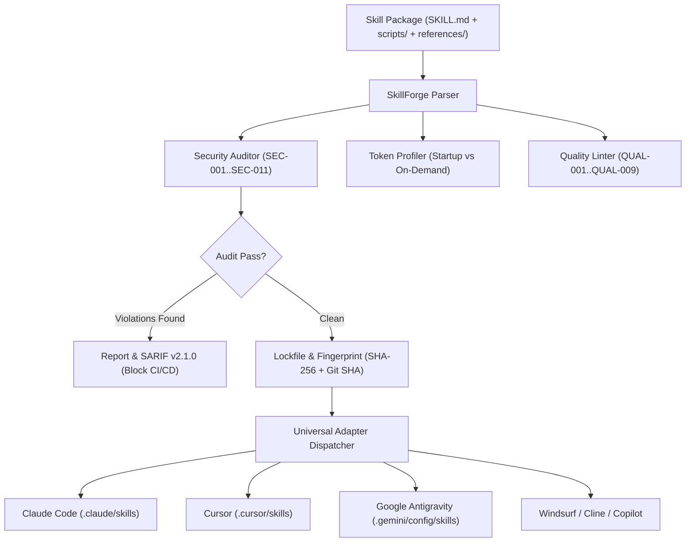

# Welcome to the SkillForge Wiki

**SkillForge** is an open-source universal package manager, static security auditor, and context token profiler for portable AI agent skills (`SKILL.md`).

It enables engineering teams and agent developers to audit third-party skills for prompt injections and malicious scripts, profile context window token overhead, enforce progressive disclosure architectures, and synchronize skills across Claude Code, Cursor, Google Antigravity, Windsurf, Cline, Codex, and GitHub Copilot.

```bash
# Instant workspace health check without installation
uvx agent-skillforge doctor

# Or install permanently via pip
pip install agent-skillforge
```

---

## Documentation Navigation

| Section | Focus Area | Key Highlights |
| :--- | :--- | :--- |
| **[Getting Started](Getting-Started)** | Installation & Workflows | 5-minute setup, workspace diagnosis, CLI commands, and lockfiles. |
| **[Architecture & Design](Architecture-and-Design)** | System Internals | AST parsers, detection pipeline, token estimators, and MCP server architecture. |
| **[Security Rules & Hardening](Security-Rules-and-Hardening)** | Vulnerability Engine | Full specification of rules SEC-001 through SEC-011 and quality audits QUAL-001 through QUAL-009. |
| **[Token Profiling & Budgets](Token-Profiler-and-Progressive-Disclosure)** | Context Optimization | Startup pointer versus on-demand body analysis, automated refactoring, and context linter. |
| **[Built-in Skills Catalog](Built-in-Skills-Catalog)** | Standard Library | 29 battle-tested zero-slop skills spanning security, debugging, and context efficiency. |
| **[Roadmap & Project Status](Roadmap-and-Status)** | Releases & Future Goals | Current production status, v0.2.0 features, and planned v0.3.0 / v1.0.0 milestones. |
| **[Troubleshooting & FAQ](Troubleshooting-and-FAQ)** | Debugging & Recipes | Resolving lockfile drift, handling audit edge cases, and CI/CD SARIF export. |

---

## Why SkillForge Exists

As coding agents shift from static prompt files to executable skills (`SKILL.md`), development teams encounter two critical failure modes:

1. **Supply-Chain Security Vulnerabilities:** Community skills are plain markdown files that instruct agents to run shell commands and scripts. Unverified skills can hide prompt injection payloads, zero-width bidirectional unicode overrides, or silent credential harvesting scripts (`~/.ssh`, `~/.aws/credentials`).
2. **Context Window Token Burn:** Skills load their name and description into the system prompt on every conversational turn. Unoptimized skills waste hundreds of tokens before the agent even starts reasoning, increasing operational API cost and degrading model attention.

SkillForge addresses both challenges deterministically with 100% offline static analysis, AST taint verification, and context window budget profiling.

---

## System Overview



---

## Quick Reference Links

- **Main Source Repository:** [github.com/gintingism/skillforge](https://github.com/gintingism/skillforge)
- **PyPI Release:** [pypi.org/project/agent-skillforge](https://pypi.org/project/agent-skillforge/)
- **HOL Registry Listing:** [hol.org/registry/plugins/gintingism/skillforge](https://hol.org/registry/plugins/gintingism%2Fskillforge)
- **Security Policy:** [SECURITY.md](https://github.com/gintingism/skillforge/blob/main/SECURITY.md)
