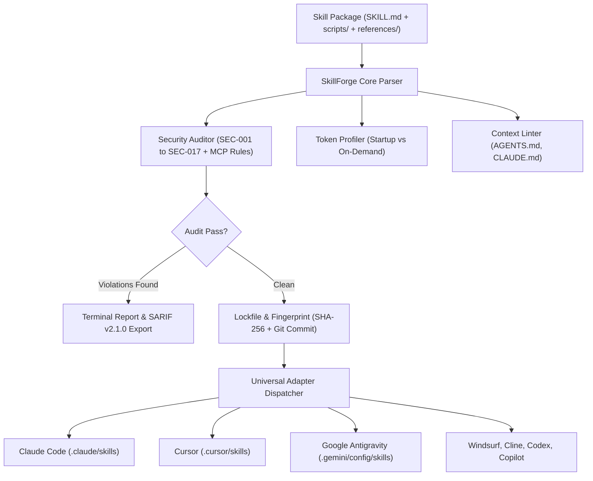

# Welcome to the SkillForge Wiki

SkillForge is an open-source package manager, offline security scanner, and context token profiler for portable AI agent skills (conforming to the open `SKILL.md` specification).

It gives engineering teams and agent builders a reliable toolset to audit third-party skills for prompt injections and malicious scripts, profile context window token weight, enforce progressive disclosure architectures, and synchronize skills across Claude Code, Cursor, Google Antigravity, Windsurf, Cline, Codex, and GitHub Copilot.

```bash
# Workspace health check without permanent installation
uvx agent-skillforge doctor

# Or install via pip
pip install agent-skillforge
```

---

## Documentation Directory

| Document | Primary Topic | What You Will Find |
| :--- | :--- | :--- |
| [Getting Started](Getting-Started) | Setup and CLI basics | 5-minute workspace setup, CLI cheatsheet, doctor checks, and lockfiles. |
| [Architecture and Design](Architecture-and-Design) | Internal engine | AST parsing, token estimator mathematics, adapter system, and native MCP server. |
| [Security Rules and Hardening](Security-Rules-and-Hardening) | Vulnerability scanner | Complete reference for SEC-001 through SEC-017, MCP-001 through MCP-007, policy suppressions, and machine sweeps. |
| [Token Profiler and Budgets](Token-Profiler-and-Progressive-Disclosure) | Context efficiency | Startup pointer vs on-demand body analysis, automated refactoring, context file linter, and local usage telemetry. |
| [Built-in Skills Catalog](Built-in-Skills-Catalog) | Standard library | Full breakdown of all 37 built-in skills spanning security, debugging, and multi-agent coordination. |
| [Cryptographic Attestation](Cryptographic-Attestation-and-Signing) | Supply chain verification | HMAC-SHA256 release signing, CycloneDX 1.6 AIBOM, SPDX 2.3, and SLSA v1.0 provenance. |
| [Language Server Protocol](Language-Server-Protocol-LSP) | Real-time IDE integration | Setting up the LSP daemon in Cursor, VS Code, and Neovim for live linting and completions. |
| [Remote Registry and Crawler](Remote-Registry-and-Crawler) | Discovery and auto-audit | Querying remote catalogs, indexing git repositories, lifecycle updates, and lockfile migration. |
| [Terminal User Interface](Terminal-User-Interface-TUI) | Interactive dashboard | Live context token allocation graphs, security grade cards, and adapter state monitoring. |
| [Roadmap and Status](Roadmap-and-Status) | Milestones and changelog | Current version status (v0.7.0), delivered v0.2.0 through v0.7.0 features, and future v1.0.0 goals. |
| [Troubleshooting and FAQ](Troubleshooting-and-FAQ) | Operational support | Resolving lockfile drift, handling audit edge cases, and exporting SARIF reports to GitHub Actions. |

---

## Why SkillForge Exists

As coding assistants transition from static prompt files to executable skills (`SKILL.md`), development teams face two recurring engineering challenges:

1. **Supply Chain Security Risks:** Community skills are plain markdown files that instruct agents to run shell commands and scripts. Unreviewed skills can execute prompt injection attacks, hide zero-width unicode characters, or exfiltrate local developer credentials from `~/.ssh` or `~/.aws/credentials`.
2. **Context Window Token Burn:** Skills load their name and description into the system prompt on every conversational turn. Bloated skills consume hundreds of tokens before the agent starts processing, driving up operational API costs and degrading model reasoning performance.

SkillForge tackles both issues deterministically using local static analysis, Python AST taint flow verification, isolated sandbox execution, and context budget profiling.

---

## Architecture Flow



---

## External Resources

* Main Source Repository: [github.com/gintingism/skillforge](https://github.com/gintingism/skillforge)
* PyPI Release: [pypi.org/project/agent-skillforge](https://pypi.org/project/agent-skillforge/)
* HOL Registry Listing: [hol.org/registry/plugins/gintingism/skillforge](https://hol.org/registry/plugins/gintingism%2Fskillforge)
* Security Disclosure Policy: [SECURITY.md](https://github.com/gintingism/skillforge/blob/main/SECURITY.md)
