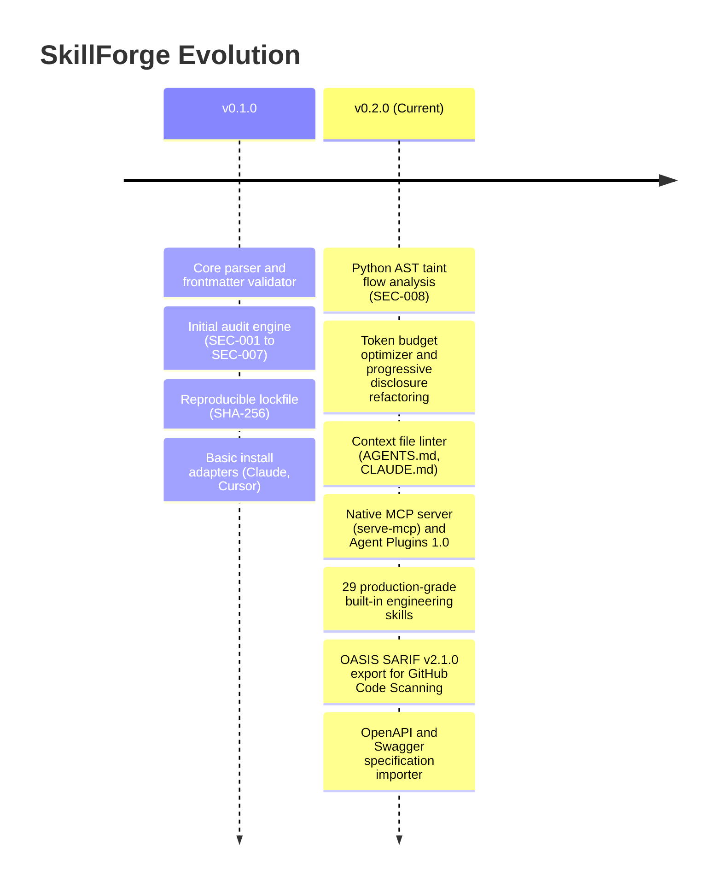

# Project Roadmap and Status

This document tracks the current development status, delivered milestones, and future roadmap for SkillForge.

---

## Current Project Status

- **Latest Stable Version:** `v0.2.0`
- **PyPI Package:** [`agent-skillforge`](https://pypi.org/project/agent-skillforge/)
- **Release Status:** Production Ready (116 unit tests passing across Python 3.11 and 3.12).
- **Standards Conformance:** Agent Plugins 1.0, Model Context Protocol (MCP), OASIS SARIF v2.1.0, and HOL Guard Supply-Chain Audit.

---

## Milestone History

### Delivered in v0.2.0 (Current Release)
- **Advanced Static Security:** Added SEC-008 (Python AST taint flow tracking), SEC-010 (deceptive installer patterns), and SEC-011 (executable binaries disguised in assets).
- **Token Profiling & Optimization:** Shipped `skillforge budget` to measure startup pointer burn versus on-demand body costs, and `skillforge optimize` for automated extraction into `references/`.
- **Context Hygiene:** Added `skillforge lint-context` to audit `AGENTS.md`, `CLAUDE.md`, and `.cursorrules` for token limits, contradictory constraints, and filler words.
- **MCP Server:** Implemented native JSON-RPC Model Context Protocol server exposing `search_skills`, `get_skill`, `get_skill_resource`, and `audit_skill`.
- **Trigger Evals:** Built `skillforge test` to execute deterministic positive and negative activation test suites against skill descriptions.
- **Expanded Adapters:** Full support for Google Antigravity, Windsurf, Cline, and universal `.agents/` registries.

---

## Future Roadmap

### v0.3.0 (In Progress: Dynamic Sandboxing & Agentic Security)
- [x] **Offline Execution Sandbox Harness:** Isolated Python subprocess runner (`skillforge audit --sandbox`) blocking outbound sockets and subprocess calls while monitoring canary environment secrets.
- [x] **Granular Allowed-Tools Enforcer (`SEC-012`):** Static verification that shell snippets and bundled scripts adhere to the tools declared in `allowed-tools`.
- [x] **OWASP 2026 Agentic Defenses (`SEC-013` & `SEC-014`):** Persistent memory/git hook poisoning detection and Lethal Trifecta compound risk analysis.
- [x] **Cisco Skill-Scanner Rule Alignment (`SEC-015`, `SEC-016`, `SEC-017`):** Obfuscation detection, fork bomb/resource abuse scanner, and unpinned package installation auditor.
- [x] **MCP Configuration Auditor (`skillforge audit-mcp`):** Security auditor for `mcp.json` detecting plaintext secrets, shell command wrappers, unpinned packages, and root filesystem grants (`MCP-001` to `MCP-004`).
- [ ] **Skill Registry Indexer:** CLI crawler to scan public GitHub repositories for `SKILL.md` packages and verify them against SkillForge security policies.
- [ ] **Interactive TUI Dashboard:** Rich terminal user interface using Textual for live token browsing, skill activation testing, and visual diffing.

### v1.0.0 (Long-Term: Universal Skill Ecosystem)
- [ ] **Cross-Agent Semantic Evaluation Benchmark:** Automated benchmark measuring trigger precision, recall, and false positive rates across diverse LLM foundation models (Claude 3.7 Sonnet, Gemini 2.5 Flash, GPT-4.5).
- [ ] **Federated Registry Signatures:** Cryptographic signing of skill releases using Sigstore / Cosign for tamper-proof public distribution.
- [ ] **Streaming LSP Server:** Language Server Protocol (LSP) daemon for live in-editor diagnostics and autocompletion of `SKILL.md` frontmatter and reference links in VS Code, Cursor, and Neovim.

---

## Proposing Features and RFCs

We welcome community proposals. To suggest an architectural improvement or new security rule:
1. Open an issue on GitHub using the [Feature Request template](https://github.com/gintingism/skillforge/issues).
2. Follow the Architecture Decision Record (ADR) format documented in `docs/architecture.md`.
3. Ensure proposed rules are deterministic and run completely offline without relying on external API calls.
