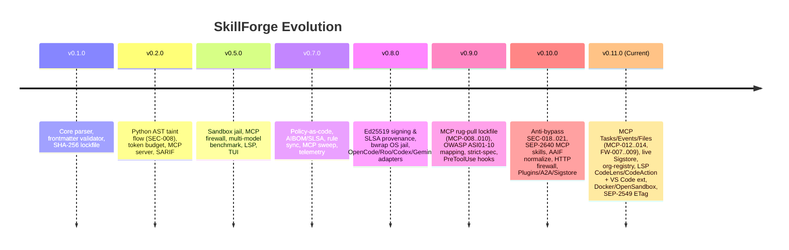

# Project Roadmap and Status

This document tracks the current development status, delivered milestones, and future roadmap for SkillForge.

---

## Current Project Status

- **Latest Stable Version:** `v0.11.0`
- **PyPI Package:** [`agent-skillforge`](https://pypi.org/project/agent-skillforge/)
- **Release Status:** Production Ready (219 unit tests passing across Python 3.11 and 3.12, `mypy --strict` clean across 35 source files).
- **Standards Conformance:** Agentic AI Foundation `agentskills.io` (strict 6-field), Agent Plugins 1.0, Model Context Protocol (`2026-07-28` + SEP-2640 `io.modelcontextprotocol/skills` + SEP-2549 `ETag` + SEP-2663/3570 Tasks + SEP-3415 Events + `io.modelcontextprotocol/files` + MCP Apps + Server Cards), Agent2Agent (`A2A` v1.0 JWS), OWASP Agentic Top 10 (`2026` `ASI01`–`ASI10`), OASIS SARIF v2.1.0, CycloneDX v1.6 AIBOM, SPDX v2.3, SLSA v1.0 Provenance (`in-toto` v1, HMAC-SHA256, Ed25519 & Sigstore Fulcio/Rekor online + offline Bundle v0.3), and HOL Guard Supply-Chain Audit.

---

## Milestone History

---

## Delivered Milestones

### v0.11.0 (Current Release: MCP Extensions, Live Sigstore, Federated Org Registry & IDE Tooling)
- [x] **MCP Tasks, Events & File Uploads (`MCP-012`–`MCP-014`, `FW-007`–`FW-009`):** Static config/Server Card audits and runtime firewall rules covering SEP-2663/3570 Tasks (`Mcp-Name` task-ID routing, `statusMessage` injection, `inputRequests` credential phishing), SEP-3415 Event subscriptions, and `x-mcp-file` upload SSRF/credential forwarding.
- [x] **Live Sigstore Fulcio CA & Rekor v2 Transparency Integration:** Optional online keyless signing and verification (`sign --sigstore --online [--staging]`, `verify-signature --sigstore-bundle --online`) via `agent-skillforge[sigstore]` (`sigstore>=4.5.0`) alongside offline bundle verification.
- [x] **Federated Trust & Curated Organization Subregistry (`skillforge org-registry`):** Declarative `registry-policy.yaml` allowlists, verified reverse-domain namespaces, duplicate-upstream detection, quarantine/approve/revoke SHA-256 pinning, and SEP-2127 Server Card drift checks.
- [x] **VS Code / Cursor / Open VSX Extension & LSP Upgrades:** Added `textDocument/codeLens` (score + Pointer/Body token counts), `textDocument/codeAction` (one-click AAIF 6-field `normalize` quick-fix), and a thin extension in `editors/vscode/` wrapping `skillforge lsp`.
- [x] **Hardened Docker & AAIF OpenSandbox Backends (`run-sandboxed --backend`):** Added zero-network, read-only `docker` and `opensandbox` execution wrappers alongside `bwrap` and `local`.
- [x] **SEP-2549 `ETag` Caching:** Deterministic weak `ETag` headers (`W/"<sha256[:16]>"`) on SEP-2640 `skills/list`, `skills/get`, and `resources/directory/read`.

### v0.10.0 & Earlier (Delivered Foundation)
- [x] **Anti-Bypass Hardening (`SEC-018`–`SEC-021`):** Whitespace inflation detection, precompiled bytecode/hidden binary scanning (`.pyc`, `.wasm`, `.class`), ZIP/office document and SVG indirection inspection (`.docx`, `.xlsx`, `.pptx`, `.zip`, `.svg`), and cipher/split-stream obfuscation plus Levenshtein typosquatting checks.
- [x] **Native MCP `io.modelcontextprotocol/skills` Extension (SEP-2640):** `skills_list`, `skills_get`, `read_skill_directory`, `get_server_capabilities`, `skill://{name}/SKILL.md`, and `skillforge mcp-manifest [--verify]` with SHA-256 file manifests.
- [x] **AAIF Strict 6-Field Spec & Normalizer (`skillforge normalize`):** Enforces the 6-field `agentskills.io` frontmatter allowlist, length limits, and portable migration of custom keys under `metadata:`.
- [x] **Live MCP Introspection, MCP Apps (`MCP-011`), Server Cards & Streamable-HTTP Firewall:** `audit-mcp --live`, `audit-mcp --server-card`, and `firewall-mcp --http-upstream` with stateless MCP `2026-07-28` header validation.
- [x] **Agent Plugins 1.0, Skill Packs & Multi-Target Hooks:** `audit-plugin` (`HOOK-001`–`HOOK-004`), `pack-bundle init|audit|install`, and multi-target/multi-event hooks (`PreToolUse`, `PostToolUse`, `UserPromptSubmit`, `--check-response`).
- [x] **A2A v1.0 Agent Card Auditor & Sigstore Bundle v0.3:** `audit-a2a` (`A2A-001`–`A2A-005` + Ed25519 JWS §8.4 signing) and keyless OIDC/Rekor Sigstore bundles (`sign --sigstore`, `provenance --sigstore`).
- [x] **Core Auditing, Sandboxing & Supply Chain:** `SEC-001`–`SEC-017`, Python AST taint flow, `audit-mcp` (`MCP-001`–`MCP-010`), `mcp-lock.json`, `firewall-mcp` (`FW-001`–`FW-006`), OWASP `ASI01`–`ASI10`, CycloneDX 1.6 AIBOM / SPDX 2.3, SLSA v1.0 provenance, `.skillforge-policy.yaml`, `scan-all`, `sync-rules`, `lsp`, `tui`, `.pre-commit-hooks.yaml`, custom rule packs, and 37 built-in skills.

---

## Next Up (v1.0.0 GA Prep)
- [ ] **Marketplace Publishing:** Publish `editors/vscode` to Visual Studio Marketplace and Open VSX Registry.
- [ ] **JetBrains LSP Bridge:** Thin IntelliJ/PyCharm plugin manifest wrapping `skillforge lsp`.
- [ ] **Live Registry Federation Sync:** Remote signed `registry-policy.yaml` mirror pull and automated CI quarantine workflows.

---

## Proposing Features and RFCs

We welcome community proposals. To suggest an architectural improvement or new security rule:
1. Open an issue on GitHub using the [Feature Request template](https://github.com/gintingism/skillforge/issues).
2. Follow the Architecture Decision Record (ADR) format documented in `docs/architecture.md`.
3. Ensure proposed rules are deterministic and run completely offline without relying on external API calls.
