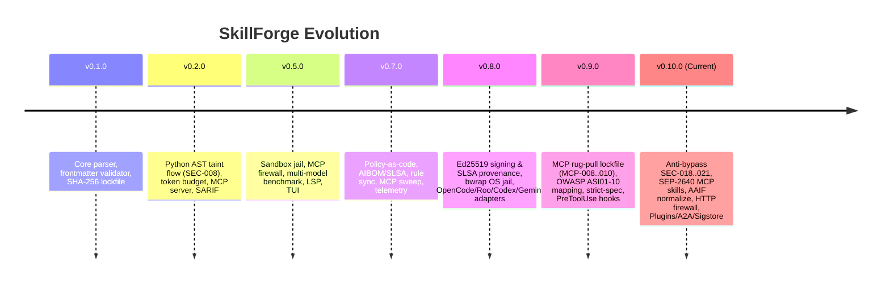

# Project Roadmap and Status

This document tracks the current development status, delivered milestones, and future roadmap for SkillForge.

---

## Current Project Status

- **Latest Stable Version:** `v0.10.1`
- **PyPI Package:** [`agent-skillforge`](https://pypi.org/project/agent-skillforge/)
- **Release Status:** Production Ready (210 unit tests passing across Python 3.11 and 3.12, `mypy --strict` clean across 34 source files).
- **Standards Conformance:** Agentic AI Foundation `agentskills.io` (strict 6-field), Agent Plugins 1.0, Model Context Protocol (`2026-07-28` + SEP-2640 `io.modelcontextprotocol/skills` + MCP Apps + Server Cards), Agent2Agent (`A2A` v1.0 JWS), OWASP Agentic Top 10 (`2026` `ASI01`–`ASI10`), OASIS SARIF v2.1.0, CycloneDX v1.6 AIBOM, SPDX v2.3, SLSA v1.0 Provenance (`in-toto` v1, HMAC-SHA256, Ed25519 & Sigstore Bundle v0.3), and HOL Guard Supply-Chain Audit.

---

## Milestone History

---

## Delivered Milestones

### v0.10.0 (Current Release: Anti-Bypass Hardening, AAIF Standards & Full Protocol Coverage)
- [x] **Anti-Bypass Hardening (`SEC-018`–`SEC-021`):** Whitespace inflation detection, precompiled bytecode/hidden binary scanning (`.pyc`, `.wasm`, `.class`), ZIP/office document and SVG indirection inspection (`.docx`, `.xlsx`, `.pptx`, `.zip`, `.svg`), and cipher/split-stream obfuscation plus Levenshtein typosquatting checks.
- [x] **Native MCP `io.modelcontextprotocol/skills` Extension (SEP-2640):** `skills_list`, `skills_get`, `read_skill_directory`, `get_server_capabilities`, `skill://{name}/SKILL.md`, and `skillforge mcp-manifest [--verify]` with SHA-256 file manifests.
- [x] **AAIF Strict 6-Field Spec & Normalizer (`skillforge normalize`):** Enforces the 6-field `agentskills.io` frontmatter allowlist, length limits, and portable migration of custom keys under `metadata:`.
- [x] **Live MCP Introspection, MCP Apps (`MCP-011`), Server Cards & Streamable-HTTP Firewall:** `audit-mcp --live`, `audit-mcp --server-card`, and `firewall-mcp --http-upstream` with stateless MCP `2026-07-28` header validation.
- [x] **Agent Plugins 1.0, Skill Packs & Multi-Target Hooks:** `audit-plugin` (`HOOK-001`–`HOOK-004`), `pack-bundle init|audit|install`, and multi-target/multi-event hooks (`PreToolUse`, `PostToolUse`, `UserPromptSubmit`, `--check-response`).
- [x] **A2A v1.0 Agent Card Auditor & Sigstore Bundle v0.3:** `audit-a2a` (`A2A-001`–`A2A-005` + Ed25519 JWS §8.4 signing) and keyless OIDC/Rekor Sigstore bundles (`sign --sigstore`, `provenance --sigstore`).
- [x] **Developer Extensibility:** Native `.pre-commit-hooks.yaml`, custom YAML/YARA-style rule packs (`audit --rules`), and opt-in prompt-hardened LLM semantic judge (`audit --llm-judge`).

### v0.9.0 & Earlier (Delivered Foundation)
- [x] **Core Auditing & Sandboxing:** `SEC-001`–`SEC-017`, Python AST taint flow, `audit --sandbox`, `run-sandboxed` with Linux `bwrap` OS jail, and OWASP `ASI01`–`ASI10` SARIF/AIBOM mapping.
- [x] **MCP Security Suite:** `audit-mcp` (`MCP-001`–`MCP-010`), `mcp-lock.json` rug-pull verification, `firewall-mcp` (`FW-001`–`FW-006`, `--wrap-config`), and machine-wide `scan-all`.
- [x] **Supply Chain & Governance:** CycloneDX 1.6 AIBOM & SPDX 2.3 (`sbom`), SLSA v1.0 `in-toto` provenance (HMAC-SHA256 & Ed25519), `.skillforge-policy.yaml` policy-as-code, `graph` topological resolver, and `sync-rules` universal context synchronizer.
- [x] **Token & Ecosystem Tooling:** `budget`, `optimize`, `refactor-progressive`, `lint-context`, `bench`, `test`, `lsp`, `tui`, `telemetry`, `check`, `update`, `migrate-lock`, and 37 built-in zero-slop skills.

---

## Future Roadmap (v1.0.0 GA & Beyond)
- [ ] **Live Fulcio/Rekor Online Transparency Integration:** Optional live network signing & inclusion proof verification against public/private Sigstore instances alongside offline bundle verification.
- [ ] **VS Code / Cursor / JetBrains Native IDE Extension:** First-party extension wrapping `skillforge lsp`, inline token budget lenses, and one-click `normalize` quick fixes.
- [ ] **MCP Tasks & Events Extensions Support:** Audit and firewall long-running MCP Tasks (`SEP-3570`) and upstream MCP Event subscriptions.
- [ ] **Federated Trust & Curated Organization Registries:** Signed team registry mirrors with automatic quarantine workflows and policy enforcement.

---

## Proposing Features and RFCs

We welcome community proposals. To suggest an architectural improvement or new security rule:
1. Open an issue on GitHub using the [Feature Request template](https://github.com/gintingism/skillforge/issues).
2. Follow the Architecture Decision Record (ADR) format documented in `docs/architecture.md`.
3. Ensure proposed rules are deterministic and run completely offline without relying on external API calls.
