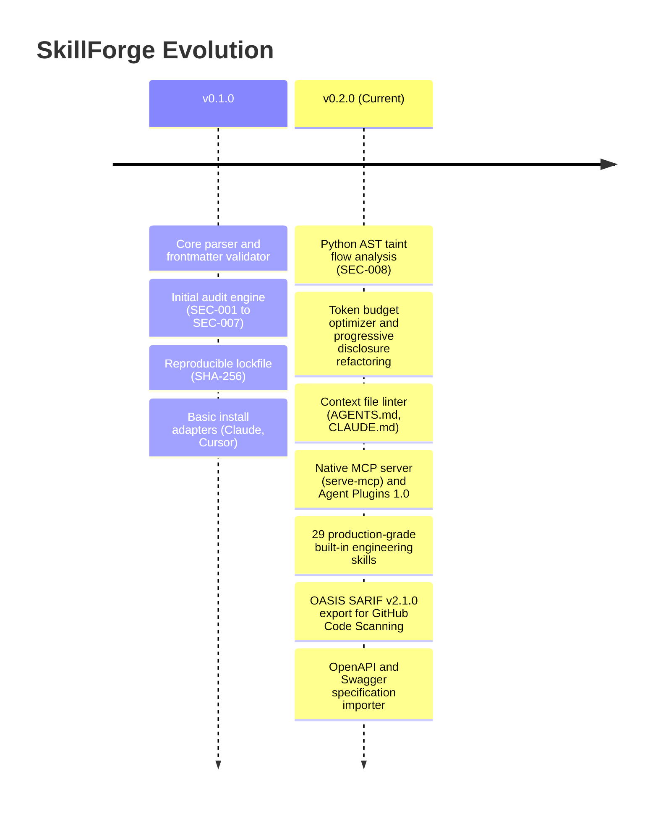

# Project Roadmap and Status

This document tracks the current development status, delivered milestones, and future roadmap for SkillForge.

---

## Current Project Status

- **Latest Stable Version:** `v0.6.0`
- **PyPI Package:** [`agent-skillforge`](https://pypi.org/project/agent-skillforge/)
- **Release Status:** Production Ready (160 unit tests passing across Python 3.11 and 3.12).
- **Standards Conformance:** Agent Plugins 1.0, Model Context Protocol (MCP), OASIS SARIF v2.1.0, CycloneDX v1.6 AIBOM, SPDX v2.3, SLSA v1.0 Provenance (`in-toto` v1), and HOL Guard Supply-Chain Audit.

---

## Milestone History

### Delivered in v0.2.0 (Current Release)
- **Advanced Static Security:** Added SEC-008 (Python AST taint flow tracking), SEC-010 (deceptive installer patterns), and SEC-011 (executable binaries disguised in assets).
- **Token Profiling & Optimization:** Shipped `skillforge budget` to measure startup pointer burn versus on-demand body costs, and `skillforge optimize` for automated extraction into `references/`.
- **Context Hygiene:** Added `skillforge lint-context` to audit `AGENTS.md`, `CLAUDE.md`, and `.cursorrules` for token limits, contradictory constraints, and filler words.
- **MCP Server:** Implemented native JSON-RPC Model Context Protocol server exposing `search_skills`, `get_skill`, `get_skill_resource`, and `audit_skill`.
- **Trigger Evals:** Built `skillforge test` to execute deterministic positive and negative activation test suites against skill descriptions.
- **Expanded Adapters:** Full support for Google Antigravity, Windsurf, Cline, and universal `.agents/` registries.

---

## Future Roadmap

### v0.3.0 (Delivered: Dynamic Sandboxing, Attestation & Ecosystem Hub)
- [x] **Offline Execution Sandbox Harness:** Isolated Python subprocess runner (`skillforge audit --sandbox`) blocking outbound sockets and subprocess calls while monitoring canary environment secrets.
- [x] **Granular Allowed-Tools Enforcer (`SEC-012`):** Static verification that shell snippets and bundled scripts adhere to the tools declared in `allowed-tools`.
- [x] **OWASP 2026 Agentic Defenses (`SEC-013` & `SEC-014`):** Persistent memory/git hook poisoning detection and Lethal Trifecta compound risk analysis.
- [x] **Cisco Skill-Scanner Rule Alignment (`SEC-015`, `SEC-016`, `SEC-017`):** Obfuscation detection, fork bomb/resource abuse scanner, and unpinned package installation auditor.
- [x] **MCP Configuration Auditor (`skillforge audit-mcp`):** Security auditor for `mcp.json` detecting plaintext secrets, shell command wrappers, unpinned packages, and root filesystem grants (`MCP-001` to `MCP-004`).
- [x] **Skill Registry Indexer & Remote Search:** CLI crawler to scan repositories for `SKILL.md` packages and index them into discovery cache (`skillforge index`, `skillforge search-remote`) with automated install security gates.
- [x] **Cryptographic Attestation & Signatures:** Tamper-evident HMAC-SHA256 release signing and manifest verification for skill packages and lockfiles (`skillforge sign`, `skillforge verify-signature`, `skillforge keygen`).
- [x] **Language Server Protocol (LSP) Daemon:** Standard LSP 3.17 server (`skillforge lsp`) delivering real-time diagnostics, frontmatter linting, and completion in Cursor, VS Code, and Neovim.
- [x] **Interactive Terminal Dashboard:** Rich terminal dashboard (`skillforge tui`) for live token budget visualization, security posture grade cards, and adapter state inspection.

### v1.0.0 (Delivered: Runtime Zero-Trust, Supply-Chain Provenance & Multi-Model Evaluation)
- [x] **MCP Runtime Security Firewall (`skillforge firewall-mcp`):** Inline JSON-RPC proxy and traffic inspector blocking prompt injections, command smuggling, credential traversal, and SSRF while redacting leaked secrets (`FW-001` to `FW-006`).
- [x] **Cross-Agent Semantic Evaluation Benchmark (`skillforge bench`):** Automated benchmark matrix measuring trigger precision, recall, F1 score, and false positive rates across multiple LLM routing profiles (`claude-sonnet-router`, `gemini-flash-router`, `gpt-strict-router`).
- [x] **Progressive Disclosure Slicer (`skillforge refactor-progressive`):** Automated refactoring engine that slices monolithic skills into `references/*.md` while verifying 100% semantic and code block preservation.
- [x] **Zero-Trust Capability Jail Runner (`skillforge run-sandboxed`):** Ephemeral filesystem and runtime capability jail blocking network sockets, subprocess spawning, and out-of-jail writes for bundled Python scripts.
- [x] **CycloneDX v1.6 AIBOM & SPDX v2.3 Generator (`skillforge sbom`):** Automated Software Bill of Materials inventorying active skills, SHA-256 digests, token budgets, MCP servers, and security vulnerabilities.
- [x] **SLSA v1.0 Provenance & in-toto Attestation (`skillforge provenance`, `verify-provenance`):** Tamper-evident `in-toto` v1 statements recording per-file SHA-256 subjects, builder metadata, and HMAC-SHA256 signatures.
- [x] **Skill Dependency Graph & Topological Resolver (`skillforge graph`):** Topological execution order solver detecting circular dependencies (`DEP-001`), missing skills (`DEP-002`), and `allowed-tools` privilege escalation (`DEP-003`).
- [x] **Universal Context Rule Synchronizer (`skillforge sync-rules`):** Single-source-of-truth compiler from `AGENTS.md` to `.cursor/rules/00-core.mdc`, `CLAUDE.md`, `.cursorrules`, `.windsurfrules`, and `.clinerules` with drift and directive conflict detection (`SYNC-001`, `SYNC-002`).

---

## Proposing Features and RFCs

We welcome community proposals. To suggest an architectural improvement or new security rule:
1. Open an issue on GitHub using the [Feature Request template](https://github.com/gintingism/skillforge/issues).
2. Follow the Architecture Decision Record (ADR) format documented in `docs/architecture.md`.
3. Ensure proposed rules are deterministic and run completely offline without relying on external API calls.
